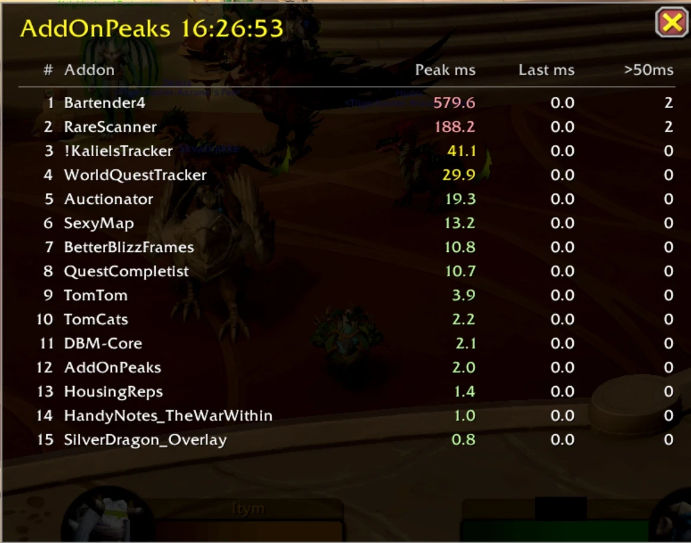

# AddOnPeaks

[Čeština](README.cs.md) · [English](README.md)

Malý addon pro World of Warcraft (retail), který ukazuje, které addony způsobují nejdelší jednotlivé zásahy (špičky) při jednom snímku. Typicky pomáhá najít příčinu pomalého vstupu do světa.

Addon čte metriky profileru pro každý addon z `C_AddOnProfiler` a zobrazí top 15 addonů v malém okně.



## Použití

| Příkaz | Efekt |
|---|---|
| `/aop` | Otevře okno s top 15 addony a uloží celou tabulku do `AddOnPeaksDB` |
| `/aop hide` | Skryje okno |

Sloupce okna:

- **Peak ms**: nejvyšší čas v jednom snímku od posledního reloadu UI (červeně >= 100 ms, žlutě >= 20 ms)
- **Last ms**: čas v posledním snímku
- **>50ms**: počet snímků, kdy addon zabral víc než 50 ms

Při odhlášení se celá tabulka uloží i do `SavedVariables` (`WTF\Account\<účet>\SavedVariables\AddOnPeaks.lua`).

## Tip: změřit vstup do světa

Metriky profileru se resetují při každém reloadu UI. Pro měření vstupu do světa nejdřív udělejte reload, pak se přihlaste a vstupte do světa, a potom napište `/aop`.

## Instalace

1. Stáhněte **`AddOnPeaks-<verze>.zip`** ze stránky [Releases](https://github.com/DanielDocekal/AddOnPeaks/releases/latest).
2. Rozbalte ZIP. Obsahuje jednu složku `AddOnPeaks`.
3. Zkopírujte složku `AddOnPeaks` do:

   ```
   World of Warcraft\_retail_\Interface\AddOns\
   ```

4. Restartujte hru nebo se odhlaste a znovu přihlaste, pak addon zapněte v seznamu addonů.

Pokud používáte WowUp nebo jiný správce addonů, tenhle addon přes něj neinstalujte, pokud v něm není uvedený. Normální způsob je ruční kopírování.

### Sestavení ZIPu vlastními silami

Spusťte `build.ps1` z kořene repozitáře. Vytvoří `dist\AddOnPeaks-<verze>.zip`.

## Požadavky

- World of Warcraft retail, verze rozhraní 120100 (patch 12.1.x)

## Poznámky

- Blizzardovy vlastní addony profiler měřit neumí.
- Profiler ukazuje hodnoty jen pro načtené addony.

## Licence

MIT, viz [LICENSE](LICENSE).
